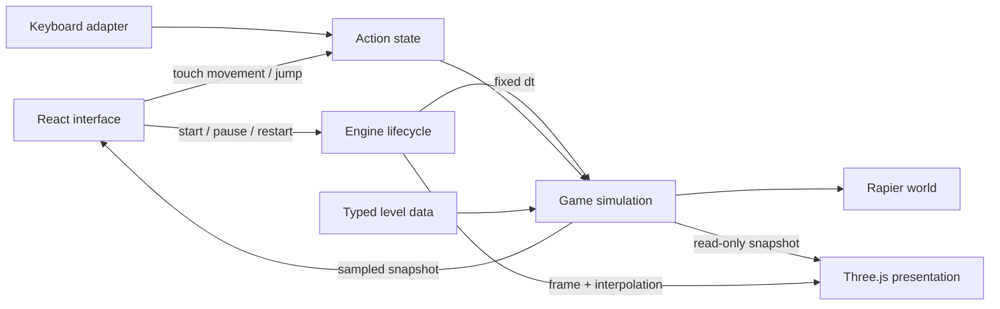

# Architecture

Paths in this guide are relative to the application root (`web/` in the repository).

Beacon is a small game with explicit ownership boundaries. The reusable part is how input,
simulation, presentation, and browser lifecycle fit together. Its two island levels are examples;
there is no entity-component framework, backend, or editor to maintain before a game needs one.

## Owners

| Owner                 | Files                                                                        | Responsibility                                                                 |
| --------------------- | ---------------------------------------------------------------------------- | ------------------------------------------------------------------------------ |
| Application shell     | `src/ui/App.tsx`, `useGame.ts`                                               | Menus, HUD, preferences, level selection, lifecycle attachment                 |
| Interface composition | `src/ui/MissionPanel.tsx`, `GameStage.tsx`                                   | Mission and level controls, canvas, overlay, touch pad, session controls       |
| Browser engine        | `src/engine/createGame.ts`                                                   | Creates owners, runs the frame loop, handles pause, resizing, errors, disposal |
| Timing                | `src/engine/fixedStepClock.ts`                                               | Accumulates frame time into bounded fixed simulation steps                     |
| Input                 | `src/engine/inputState.ts`, `keyboard.ts`, `src/ui/TouchControls.tsx`        | Converts devices into movement, sprint, and jump actions                       |
| Rules                 | `src/game/simulation.ts`, `objectives.ts`                                    | Session phases, movement intent, collecting, completion, respawning            |
| Physics               | `src/game/physics.ts`, `config.ts`                                           | WASM initialization, colliders, character movement, world lifetime             |
| Content               | `src/game/types.ts`, `levels.ts`, `validateLevel.ts`                         | Typed layout, unique identities, shape and coordinate validation               |
| Presentation          | `src/render/renderer.ts`, `world.ts`, `player.ts`, `beacon.ts`, `scenery.ts` | Camera, geometry, animation, lighting, visual feedback                         |
| GPU ownership         | `src/render/resources.ts`                                                    | Releases owned geometry, materials, and textures once                          |

`GameSimulation` exposes actions and snapshots without importing Three.js or React. Its tests
run against real Rapier in Node. `GameRenderer` consumes snapshots and never determines collisions,
collections, or victory. A mesh disappearing means the simulation collected its object, not the
other way around.

## Time and state

`movementConfig.fixedStep` is 1/60 second. One engine RAF loop uses that step for physics and rules,
then renders between `previousPosition` and `position`. `fixedStepClock.ts` permits at most six
simulation updates per rendered frame and discards excessive stalled time. This keeps a delayed
browser from executing an unlimited backlog; the run timer measures simulated play time.

The renderer receives frame delta for camera and visual interpolation. It does not call
`world.step()`. React receives snapshots at approximately 10 Hz, plus immediate phase, collection,
fall, and explicit action updates. Scene transforms never depend on React rendering every frame.

The phases are `ready`, `playing`, `paused`, and `won`. Only `playing` advances simulation time.
`restart()` clears the run and starts playing. Falling increments the fall count and returns the
player to the spawn while preserving collected cells. A level change disposes the complete old
game and creates a new one from the selected definition.

## Movement and world data

Coordinates are right-handed, Y-up, with one world unit treated as one meter. A solid's `size`
contains full dimensions and `position` is its center. Physics converts those dimensions to
Rapier cuboid half-extents. The player uses a position-based kinematic capsule; its position is
the capsule center, and gravity/jump velocity belong to the simulation.

Movement intent is normalized and multiplied by the fixed timestep before the character controller
resolves obstacles. The corrected movement is applied through the body's next kinematic position,
then the world advances. Render geometry uses the same level dimensions, but decorative vegetation,
water, and distant scenery are not automatically collidable.

Level validation catches malformed data, duplicate object IDs, invalid dimensions, and an invalid
fall boundary. It cannot prove that every pickup or goal is reachable. Traversal is a separate
gameplay test, including platform height, jump distance, and room for the capsule.

## Lifecycle

`useGame.ts` creates one AbortController per level instance. The engine awaits Rapier startup and
disposes a world whose initialization finishes after cancellation. Renderer construction failures
release physics; initial draw failures release both owners. The returned handle and signal cleanup
are idempotent, including React Strict Mode's setup/cleanup cycle.

The engine owns keyboard listeners, resize observation, context-loss handling, and the RAF handle.
Keyboard actions require canvas focus; key releases are accepted after focus moves. Touch control
capture ends on release, cancellation, or lost capture. Blur and hidden-page events clear actions
and pause play. Resume resets the clock, so hidden-tab time is not simulated.

Ready, paused, and completed scenes do not maintain a continuous render loop. Resizing or changing
graphics preferences can redraw a still frame. A context loss stops play and exposes a retry path
that recreates the game. A failed WebGL or physics startup leaves a readable interface.

`RenderResources` tracks shared resources in a set. Renderer disposal clears the scene, shadow
resources, tracked resources, and the Three.js renderer. Physics disposal frees the Rapier world.
Replacing a level must not accumulate listeners, active loops, or old world instances.

## Scope and delivery

The current example has no external model downloads or server calls. Local storage holds display
preferences and per-level personal bests; a player can change these values, so they are not a
competitive leaderboard. Multiplayer or shared scores require a separate authority design.

The application lives in the repository’s `web/` directory with Vite, its own committed lockfile, and an Amazi-compatible
Dockerfile. Amazi application registration is outside this Git repository. Preserve runtime `PORT`,
the public container bind address, and source-path registration when importing or extending it.

See [Extending the game](extending.md) for changes that exercise these boundaries and
[Research](research.md) for the library choices and primary references.
